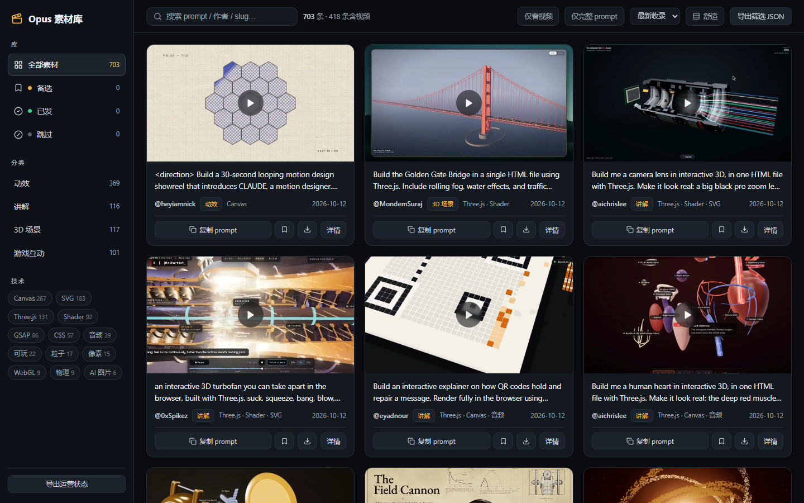
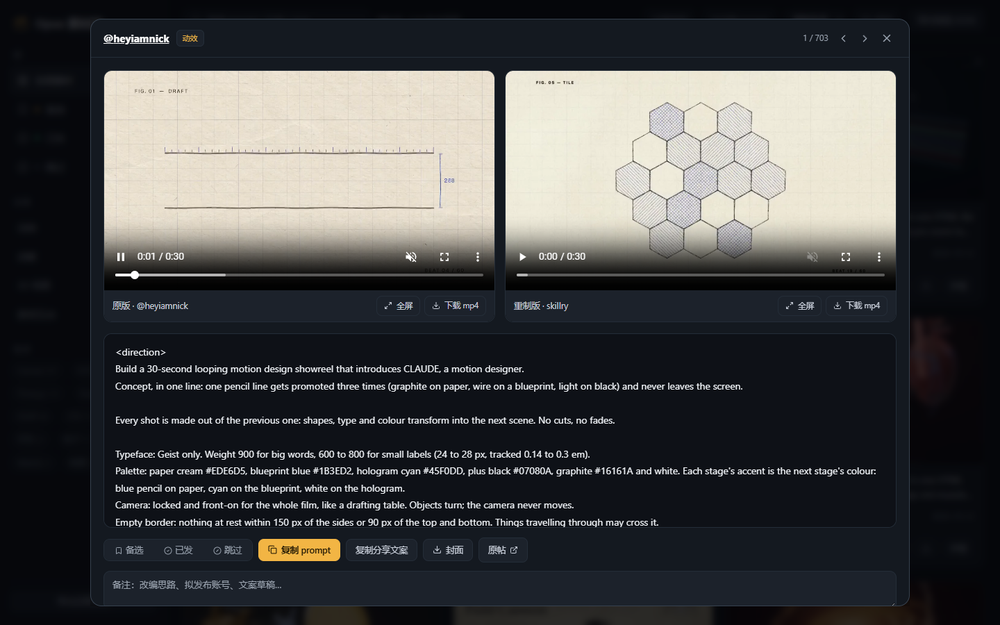

# Opus 5.5 视频素材工作站

703 条 AI 代码动画 prompt 素材的本地运营库：刷视频、抄 prompt、下载 mp4、
标记发布状态，服务自有自媒体账号的选题与二创。

## 截图





## 使用

```powershell
python scripts/serve.py        # http://localhost:8791
```

`serve.py` 优先服务 `web/dist`（React 版），同时提供 `/dl/` 下载代理与
`/media/`、`/data/` 静态目录。仓库根的旧版 `index.html` 仍可双击打开，
作为无构建环境的备用只读页面。

页面功能：

- 界面中英文切换（顶栏 EN/中文，按浏览器语言自动选默认）
- prompt 与标题内置中文机翻（Argos 离线模型），详情弹窗可切换
  「译文 / 原文」，复制按钮复制当前显示的版本；搜索同时命中中英文
- 左栏：全部 / 备选 / 已发 / 跳过 分组计数，分类筛选，技术栈标签云
- 悬停卡片海报淡入预览视频，点击进详情
- 详情弹窗：原版 / 重制版并排播放，全屏按钮 + 双击全屏，← → 键翻页，
  prompt / 分享文案一键复制，状态标记（备选 / 已发 / 跳过）与备注
- 卡片与详情里的下载按钮走 `/dl/` 强制附件下载，多个加入右下角队列顺序执行
- 导出当前筛选 JSON；「导出运营状态」备份标记与备注

运营状态（备选 / 已发 / 跳过 + 备注）存在浏览器 localStorage，
建议定期用左栏底部「导出运营状态」备份。

## 前端开发

```powershell
cd web
npm install
npm run dev      # vite 开发服，/data /media /dl 代理到 8791（需先起 serve.py）
npm run build    # 产物到 web/dist，serve.py 自动接管
```

## 镜像视频到本地

```powershell
python scripts/download_media.py                    # 全部（可中断续传）
python scripts/download_media.py --kinds original   # 只下完整版原视频
python scripts/download_media.py --limit 20         # 先试下 20 条
```

文件落在 `media/{slug}/`（original.mp4、remake.mp4、card.mp4、poster.webp 等）。
已镜像的条目页面显示「本地」徽标并自动改用本地文件播放。

不镜像也能下载：`serve.py` 的 `/dl/{slug}/{file}` 端点优先给本地文件，
没有就代理 CDN 并强制附件下载，页面上的下载按钮随时可用。

注意：418 条 `has_remake` 的条目在 Skillry CDN 上有托管 mp4；其余 285 条
视频只存在于原作者的 X 帖子里，页面提供原帖链接。

## 数据更新

```powershell
# 1. 重新拉取上游 videos.json 覆盖 data/videos.json
# 2. 重新抓 skillry 列表页的卡片 URL 覆盖 data/media_urls.json
# 3. 重新生成数据
python scripts/build_data.py
```

数据文件：

- `data/videos.json` — 上游原始数据集
- `data/media_urls.json` — 从 skillry.dev 列表页抓取的带 hash 卡片 URL
- `data/videos.enriched.json` / `data.js` — 合并后的成品数据（由 build 脚本生成）
- `data/videos.zh.json` — 中文机翻缓存（`scripts/translate_data.py` 生成，
  需先 `pip install argostranslate` 并装 en→zh 模型；可中断续跑）

## 联系方式

- 邮箱：[dodoaling@163.com](mailto:dodoaling@163.com)
- X (Twitter)：[@DodoAling](https://x.com/DodoAling)
- 微信：`dodoaling`
- 微信公众号：`DodoAling` —— 扫码关注，或在微信内搜索：


